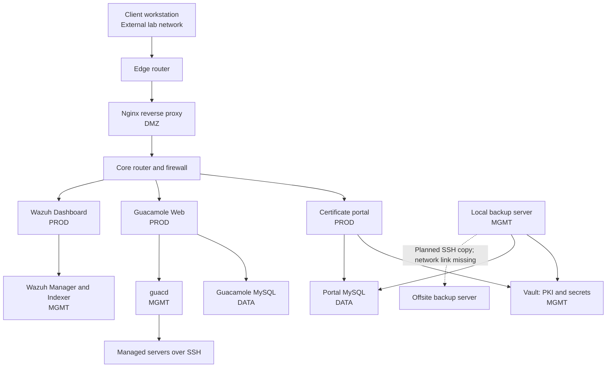
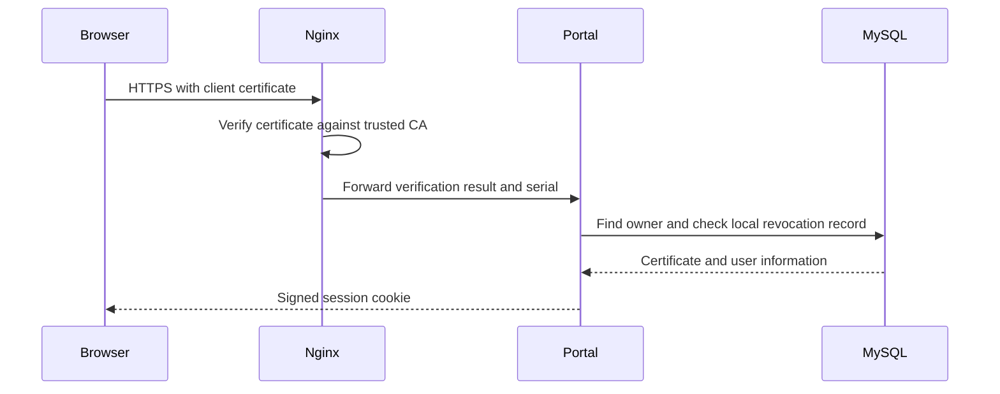

# iMovies CA — Certificate-Based Identity Lab

iMovies CA is an Applied Security lab that demonstrates how a company can issue digital identities to employees and use them to control access to internal services.

An employee signs in with a username and password, requests a personal certificate, and imports it into their browser. Later, the browser can use that certificate to authenticate the employee. The surrounding infrastructure provides network segmentation, remote administration, monitoring, and backups.

The lab runs as Docker containers connected by **Kathara**, a network emulation framework. Each container represents a workstation, router, or server.

**Project status:** this repository contains code, configuration, and saved service data. It also contains explicit authentication bypass code, embedded secrets, and incomplete configuration. Treat it as a local educational lab, not a production deployment. It does not currently provide a complete installation from an empty state.

## Contents

- [Project goals](#project-goals)
- [Key concepts](#key-concepts)
- [Architecture](#architecture)
- [User workflows](#user-workflows)
- [Application and data design](#application-and-data-design)
- [Monitoring and backups](#monitoring-and-backups)
- [Running the lab](#running-the-lab)
- [Repository guide](#repository-guide)
- [Known limitations](#known-limitations)

## Project goals

The central feature is the **certificate lifecycle**: issuing an identity, using it to authenticate, tracking its validity, and revoking it when it should no longer be trusted.

| Goal | Implementation |
| --- | --- |
| Issue and revoke certificates | HashiCorp Vault PKI |
| Provide employee self-service | Python portal built with FastAPI and Jinja2 |
| Authenticate browsers with certificates | Nginx and mutual TLS |
| Separate user privileges | MySQL role membership and certificate checks |
| Manage application secrets | Vault KV, AppRole, and dynamic database credentials |
| Centralize remote administration | Apache Guacamole and guacd |
| Limit network access | Kathara networks, FRR routing, and iptables |
| Monitor security events | Wazuh agents, Manager, Indexer, and Dashboard |
| Support recovery | Vault snapshots and MySQL exports archived with BorgBackup |

The intended benefit is to reduce routine password use while keeping identity and permissions under central control. Passwords still exist for initial enrollment, exported key files, and some services.

## Key concepts

**Certificate authority (CA).** A trusted issuer that signs certificates. A certificate associates an identity with a public key. The design describes an internal intermediate CA; certificate artifacts are included, but the complete provisioning procedure is missing.

**Private key.** The secret needed to prove ownership of a certificate. Possessing the public certificate alone does not let someone authenticate as its owner.

**Mutual TLS (mTLS).** With ordinary HTTPS, the browser checks the server's certificate. With mTLS, the server also checks a certificate presented by the browser.

**PKCS#12 (`.p12`).** A password-protected file containing a private key, its certificate, and the CA chain. Importing it into a browser makes the identity available for certificate authentication.

**Revocation.** Marking a certificate as no longer trusted before it expires. A certificate revocation list (CRL) publishes revoked certificates, but services must check revocation for it to take effect.

**AppRole.** The Vault authentication mechanism used by services here. A RoleID and SecretID are exchanged for a token with permissions defined by a Vault policy.

## Architecture

### Overall layout

The browser reaches Nginx in the DMZ. Nginx forwards requests to services in the production network. Applications reach databases and management services through the core router.

The diagram shows the main relationships. Traffic between internal network zones passes through the core router, omitted from some arrows for readability.



### Network zones

The network named `internet` is the lab's simulated external segment; it is not the public Internet. Short addresses such as `.2` refer to the subnet in the same row.

| Zone | Subnet | Machines and addresses |
| --- | --- | --- |
| External (`internet`) | `10.50.0.0/24` | Client `ext_client01`: `.3`; edge router: `.1` |
| DMZ | `10.50.10.0/24` | Nginx `dmz_rp01`: `.2`; edge router: `.1`; core router: `.254` |
| Production (`prod`) | `10.50.20.0/24` | Portal `prod_web01`: `.2`; Wazuh Dashboard: `.11`; Guacamole Web: `.20`; gateway: `.1` |
| Data (`data`) | `10.50.30.0/24` | Portal MySQL `data_db01`: `.2`; Guacamole MySQL `data_db02`: `.3`; gateway: `.1` |
| Management (`mgmt`) | `10.50.40.0/24` | Vault: `.2`; local backup: `.4`; Wazuh Manager: `.10`; Wazuh Indexer: `.11`; guacd: `.20`; gateway: `.1` |
| Offsite (`offsite`) | `10.60.60.0/24` | Offsite backup: `.2`; intended gateway: `.1` |

The offsite gateway is configured in FRR, but its interface is not attached to `offsite` in `lab.conf`. That path is incomplete in the declared topology.

### Routing and filtering

FRR configures **static routes** on two routers. The edge router connects the external segment to the DMZ. The core router connects the internal zones. No dynamic routing protocol is configured.

Router firewalls use default-drop policies with explicit exceptions and allow replies to established connections. Several machines also apply host firewall rules.

| Source → destination | TCP port | Purpose |
| --- | --- | --- |
| Client → Nginx | `443` | HTTPS |
| Nginx → portal | `8000` | Application requests over HTTP |
| Nginx → Guacamole Web | `8080` | Remote-access interface over HTTP |
| Nginx → Wazuh Dashboard | `5601` | Dashboard over HTTPS |
| Portal / Nginx → Vault | `8200` | Vault API over HTTPS |
| Portal → portal MySQL | `3306` | Application data |
| Vault → portal MySQL | `3306` | Dynamic database account management |
| Guacamole Web → Guacamole MySQL | `3306` | Connections and permissions |
| Guacamole Web → guacd | `4822` | Remote-session proxy protocol |
| guacd → managed servers | `22` | SSH sessions |
| Agents → Wazuh Manager | `1514`, `1515` | Events and enrollment |
| Local backup → offsite backup | `22` | Intended rsync-over-SSH copy |

These are the main configured flows, not a claim that every path works. Some rules are inconsistent, and some containers also use bridged interfaces or host-published ports. See [known limitations](#known-limitations).

### Service names and reverse proxy

The client resolves these names to Nginx at `10.50.10.2`:

| URL | Purpose | Access behavior |
| --- | --- | --- |
| `https://portal.imovies.lan` | Enrollment and certificate management | Password or certificate login |
| `https://portal.imovies.lan/admin/dashboard` | CA statistics | `CA_ADMIN` certificate OU plus application checks |
| `https://pki.imovies.lan/ca.pem` | CA certificate publication | Proxied to Vault |
| `https://pki.imovies.lan/crl.pem` | CRL publication | Proxied to Vault |
| `https://guac.imovies.lan/guacamole` | Remote administration | Main Nginx host requires a client certificate |
| `https://*.auth.guac.imovies.lan` | Guacamole certificate authentication | Wildcard names resolved by client dnsmasq |
| `https://kibana.imovies.lan` | Wazuh Dashboard | Dashboard credentials; no SOC certificate-role check in Nginx |

Nginx requests an optional client certificate on ordinary portal pages so new users can enroll. It requires successful certificate verification for `/login-cert` and `/admin/`. The administrative path also checks for `OU=CA_ADMIN`.

Vault Agent authenticates with AppRole and renders Nginx TLS certificate templates. Template commands request an Nginx reload.

## User workflows

### 1. Enroll and download an identity

1. Open the portal and sign in with an existing employee account.
2. Review the profile information.
3. Choose an available certificate role. The server checks role membership in MySQL.
4. The portal derives the certificate name from the account ID, for example `ps.imovies.lan`, and passes the email as an alternative name.
5. It asks Vault to issue a certificate with a requested lifetime of 720 hours (30 days), subject to Vault role limits.
6. Vault returns the certificate, private key, and issuer information.
7. The portal records the certificate and uses OpenSSL to package the identity into a `.p12` file.
8. Vault Transit encrypts an archive copy for MySQL storage.
9. The browser downloads the `.p12`, ready to import.

The export uses a user-supplied password or a default obtained from Vault if no password is entered.

**Where is the key generated?** Vault's issuance API generates it and returns it to the portal. The private key passes through application memory and temporary files during packaging. This is not a workflow where the workstation generates a key and sends only a certificate signing request.

### 2. Sign in with a certificate



The portal trusts Nginx to verify TLS certificates. Nginx overwrites the certificate-identity headers, and the portal's host firewall permits application traffic only from Nginx.

The application then checks that the certificate is recorded locally and is not revoked. A certificate signed by the CA but unknown to the portal cannot use this login route.

### 3. Use role-based access

| Application role | Vault PKI role | Certificate OU | Intended purpose |
| --- | --- | --- | --- |
| `employee` | `user_cert` | `EMPLOYEE` | Employee identity |
| `ca_admin` | `ca_admin_cert` | `CA_ADMIN` | CA administration |
| `sys_admin` | `sys_admin_cert` | `SYS_ADMIN` | System administration identity |

For the CA dashboard, Nginx checks the OU, and the portal checks the certificate's serial, local revocation status, and the owner's current `ca_admin` role.

Nginx does not enforce a `SYS_ADMIN` OU for Guacamole or a `SOC_ANALYST` OU for Wazuh in the checked-in configuration. Intended identities should not be confused with implemented role checks.

### 4. Revoke a certificate

A signed-in user can revoke their own certificates. An administrator identified by a certificate and application role can revoke another user's certificate.

The portal calls Vault's revocation API, records the serial in MySQL, updates counters, and writes an audit event. Certificate login and administrative certificate checks consult the local revocation table.

The CRL is published through Nginx, but Nginx has no `ssl_crl` directive in this configuration. Revocation is not uniformly enforced across services. Existing portal cookies are not immediately invalidated when their original certificate is revoked.

### 5. Administer servers with Guacamole

Guacamole Web provides the browser interface. **guacd** establishes the actual SSH connection:

```text
Browser → Nginx → Guacamole Web → guacd → SSH server
```

Browser certificate authentication and SSH authentication are separate. Startup scripts authorize a shared SSH public key on several target accounts; they do not implement a separate SSH certificate identity for every employee.

A directory for recordings is created, but this alone does not establish that recording is enabled for every connection.

## Application and data design

### Portal source and routes

```text
lab/Images/portal/app/
├── portal_main.py       Routes, authentication, enrollment, revocation
├── vault_client.py      Vault authentication and API calls
├── db.py                SQLAlchemy engine and database sessions
├── models.py            Database table mappings
├── requirements.txt     Python dependencies
└── templates/           Jinja2 HTML pages
```

FastAPI handles requests, Uvicorn runs the application, SQLAlchemy and PyMySQL access MySQL, and Requests communicates with Vault. Most business logic lives in `portal_main.py`.

| Route | Behavior |
| --- | --- |
| `GET /` | Home page |
| `GET /login`, `POST /login` | Password sign-in |
| `POST /login-cert` | Certificate sign-in |
| `POST /logout` | Clear session cookie |
| `GET /profile`, `POST /profile` | View or update profile |
| `GET /enroll`, `POST /enroll` | List certificates or issue one |
| `POST /revoke` | Revoke a certificate |
| `GET /admin/dashboard` | View CA statistics |

Password verification supports legacy SHA-256 hashes and PBKDF2-HMAC-SHA256 with 200,000 iterations. A successful legacy login upgrades the stored hash.

Session cookies contain an account ID, timestamp, and HMAC signature. They are signed, not encrypted, use `Secure`, `HttpOnly`, and `SameSite=Lax`, and expire after one hour according to server-side validation. Several state-changing forms also require an HMAC-based CSRF token.

**Which source copy is built?** `lab/portal_src/app/` contains another version. The Dockerfile copies **`lab/Images/portal/app/`** into the image. The two differ, including in authentication behavior. Editing `portal_src` alone does not update the image built by `build.sh`.

### Databases

Two MySQL containers separate portal data from Guacamole data.

| Portal table | Purpose |
| --- | --- |
| `users` | Existing employee accounts and profiles |
| `roles`, `user_roles` | Role definitions and membership |
| `certs` | Owners, roles, serials, validity dates, and certificate PEM |
| `revocations` | Local revocation records |
| `audit_events` | Application actions and metadata |
| `admin_stats` | Issuance and revocation counters |
| `key_archive` | Transit-encrypted PKCS#12 archives |

The `p12_b64` archive field actually stores a Vault Transit ciphertext string. There is no portal route for retrieving and decrypting these archives in the current code.

Guacamole has its own database for users, connections, permissions, and history according to its configuration.

### Vault

| Feature | Use |
| --- | --- |
| PKI | Issue and revoke certificates |
| KV | Supply portal secrets |
| Database secrets engine | Supply dynamic MySQL credentials |
| Transit | Encrypt exported identity archives |
| AppRole | Authenticate services with scoped policies |
| Raft storage | Persist state and support snapshots |

Portal secrets include session and CSRF keys, a password-hashing secret, and a default PKCS#12 export password. Services have different policies: the portal can issue user certificates, the proxy can request server certificates, and the backup service can obtain snapshots and database backup credentials.

Vault runs as a single node with persistent storage. Using Raft does not make this topology highly available.

## Monitoring and backups

### Wazuh

Agents send events to the **Manager**, the **Indexer** stores searchable data, and the **Dashboard** provides the web interface. The custom images use Wazuh `4.14.1`.

Configurations include file integrity checks, system inventory, vulnerability detection, and security configuration assessment. Actual coverage depends on agent connectivity and runtime configuration.

Portal audit records are stored in MySQL. The repository does not establish that every application audit event is also ingested into Wazuh. Vault operational logs should likewise not be assumed to provide a complete API audit trail.

### Backups

The local backup script:

1. Authenticates to Vault using a backup AppRole.
2. Downloads a Vault Raft snapshot and archives it with Borg.
3. Requests dynamic credentials for `data_db01`.
4. Exports that MySQL server using `mysqldump` and gzip.
5. Archives the export in a separate Borg repository.
6. Applies retention and cleans staging files older than two days.

Borg uses `repokey-blake2` encryption. Retention keeps 7 daily, 4 weekly, and 6 monthly archives.

| Task | Scheduled time in the container's timezone |
| --- | --- |
| Local backup | Daily at `02:00` |
| Offsite rsync over SSH | Daily at `03:00` |

The script exports **`data_db01` only**. A policy mentions a second database role, but `data_db02` is not exported. Offsite copying also requires fixing the missing network attachment.

Intermediate snapshots and SQL exports remain in `/backup/tmp` until cleanup; Borg encryption does not encrypt those staging files. Offsite synchronization uses `rsync --delete`, propagating local deletions to the remote copy.

## Running the lab

### Requirements and current blockers

Use a Linux environment with Docker, Kathara, Bash, and permission to run the host changes in `start.sh`. Building images requires access to registries and package repositories. This is a multi-service lab; no measured minimum RAM requirement is provided.

Before starting:

- `start.sh` loads image archives from `lab/Pre-Built/`, absent from this checkout. Build them first or obtain compatible archives.
- Vault and MySQL rely on saved state. The referenced `shared/scripts/provision_vault.sh` is absent. Building images does not provision a fresh PKI, database schema, users, or Vault roles.
- Vault must be initialized and unsealed. When sealed, its startup script expects a local unseal-key file and attempts to delete it after use; later restarts require attention.
- The offsite network and other inconsistencies below need correction for the complete intended workflow.

These instructions describe the supplied scripts. Successful startup has not been verified for this checkout.

### Build and start

From the repository root:

```bash
cd lab
bash build.sh
bash start.sh
```

`build.sh` builds images and saves archives under `Pre-Built/`. `start.sh` loads them, prepares storage directories and ownership, sets the host's `vm.max_map_count` to `262144`, and restarts Kathara. It then restarts the client with host-home and shared-directory mounts disabled.

Open the browser workstation at **http://localhost:6080**. Access the `.imovies.lan` URLs **inside that workstation's browser**: its startup script installs the root CA, imports a supplied client identity, and configures name resolution. The host browser does not receive these settings automatically.

### Demo access

These values were documented for the saved lab state. Re-provisioning or changing persistent data may change them.

| Access | Username / identity | Password |
| --- | --- | --- |
| Browser workstation | noVNC access | `money4band` |
| Portal | `ps` | `KramBamBuli` |
| Wazuh Dashboard | `kibanaserver` | `kibanaserver` |
| Supplied browser certificate | `ms.imovies.lan`, described as `SYS_ADMIN` | Imported by the client startup script |

For a portal demonstration:

1. Open `https://portal.imovies.lan` in the lab browser.
2. Sign in with the demo account and review the profile.
3. Request an available certificate role.
4. Download the `.p12` and import it into that browser using the export password.
5. Use certificate login. With an issued `CA_ADMIN` certificate, visit `/admin/dashboard`.

For Guacamole, open `https://guac.imovies.lan/guacamole` and select certificate/smartcard authentication. The saved client is intended to contain the `ms.imovies.lan` identity already.

### Stop

From `lab/`:

```bash
bash stop.sh
```

This invokes `kathara lclean`. Service data stored in host-mounted directories remains outside the containers.

## Repository guide

```text
README.md
lab/
├── lab.conf                 Machines, networks, images, and volumes
├── lab.dep                  Startup dependencies
├── build.sh                 Build images and export archives
├── start.sh                 Load archives and start Kathara
├── stop.sh                  Clean up the Kathara lab
├── Images/                  Dockerfiles and image build inputs
│   └── portal/app/          Portal source used by the build
├── portal_src/app/          Alternate portal source copy
├── <machine>.startup        Network, firewall, and service setup
├── <machine>/               Files copied into that machine
├── shared/                  CA material, Wazuh configuration, shared assets
├── imovies_data/            Active portal MySQL volume
├── guac_data/               Active Guacamole MySQL volume
├── vault_data/              Active Vault storage volume
└── backup_local_data/       Local backup repositories and staging
```

For example, `lab/dmz_rp01/etc/nginx/nginx.conf` becomes `/etc/nginx/nginx.conf` on `dmz_rp01`. Its companion `dmz_rp01.startup` configures that machine at startup.

The older `mysql_data/` directory is present, but `lab.conf` mounts `imovies_data/` for the portal database. Not every saved data directory is actively used.

Useful entry points:

- [Topology](lab/lab.conf) and [startup dependencies](lab/lab.dep)
- [Core firewall](lab/core_router01.startup) and [routes](lab/core_router01/etc/frr/frr.conf)
- [Nginx configuration](lab/dmz_rp01/etc/nginx/nginx.conf)
- [Portal routes](lab/Images/portal/app/portal_main.py) and [models](lab/Images/portal/app/models.py)
- [Vault client](lab/Images/portal/app/vault_client.py) and [portal policy](lab/mgmt_vault01/vault/config/portal.hcl)
- [Backup script](lab/mgmt_bkp_local01/usr/local/bin/run_backups.sh) and [offsite sync](lab/mgmt_bkp_local01/usr/local/bin/sync_offsite.sh)

## Known limitations

These findings come from the checked-in code and configuration. They distinguish the intended design from the implementation; they are not results of a running deployment test.

| Finding | Consequence |
| --- | --- |
| Explicit authentication bypass in the portal build input | A debug path can impersonate an existing user without checking the password and logs it as an ordinary login. It is absent from the alternate `portal_src` copy. |
| Embedded Guacamole credentials and private SSH key | `Images/guacamole/user-mapping.xml` defines a credential-based connection to Vault as `root`. Runtime exposure depends on the authentication providers loaded. |
| Secrets in the repository | Private keys, AppRole SecretIDs, service passwords, and an unseal-key file make possession of the checkout security-sensitive. |
| Missing provisioning and image archives | The start command is not a complete fresh-install procedure. |
| Missing offsite router interface in `lab.conf` | FRR and firewall rules reference `eth4`, but Kathara does not attach it to the offsite network. |
| Incorrect Wazuh firewall destinations on several hosts | Agent ports are permitted toward Vault at `10.50.40.2` instead of the Manager at `10.50.40.10`, potentially blocking monitoring. |
| No renewal of dynamic MySQL credentials in the portal | Credentials are fetched when the SQLAlchemy engine is created; expired leases may break later connections. |
| Certificate issuance commits before export validation completes | A later failure can leave an issued certificate without a successfully delivered identity file. |
| Incomplete revocation coverage | The portal checks its local table; Nginx does not load a CRL, and existing cookies survive certificate revocation until expiry. |
| Shared SSH administration key | Target access does not use individual SSH keys or SSH certificates for each employee in the startup scripts. |
| HTTP on internal application links | Portal and Guacamole backend traffic is not encrypted by this configuration. |
| Bridged interfaces and host-published ports | These create paths outside the intended proxy-only access model. |
| Incomplete backup coverage | The separate Guacamole database is not exported; staging files and offsite copying need separate protection. |
| Broad filesystem permissions | `data_db01.startup` applies recursive `0777` permissions to the MySQL data directory. |
| Single instances of critical services | The topology does not implement high availability for Vault, MySQL, or the proxy. |

The project was developed for Applied Security education. It connects identity, application authorization, network controls, monitoring, and recovery, and makes their implementation gaps available for study.
